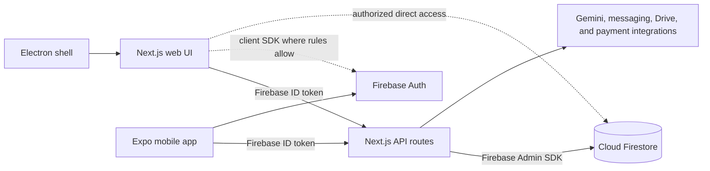

# NarayanaOS Monorepo Guide

Updated: 2026-10-24

This document describes the repository as it exists in the current workspace. It is a navigation and architecture guide, not a security or production-readiness certification. Some older reports and the root README describe earlier versions of the project; prefer package manifests and current source when details conflict.

## Project at a Glance

NarayanaOS is a school ERP maintained as an npm-workspaces monorepo. Its main products are a Next.js web application, an Expo / React Native mobile application, and an Electron desktop wrapper. Firebase Authentication and Cloud Firestore provide identity and persistence. The web app's Next.js API routes form the server-side application layer and use the Firebase Admin SDK for privileged operations.

| Workspace | Purpose | Main technologies |
| --- | --- | --- |
| `apps/web` | Main ERP, portals, and server API | Next.js 14 App Router, React 18, TypeScript, Tailwind CSS, Firebase, Firebase Admin |
| `apps/mobile` | Mobile workspaces for school roles | Expo 57, Expo Router, React Native 0.86, React 19, TypeScript |
| `apps/desktop` | Windows Electron shell and installer packaging | Electron 33, Node.js scripts, packaged web resources |
| `packages/shared` | Types, validation, shared domain logic, Firebase client initialization, demo data | TypeScript, Zod, Firebase, XLSX |

The root `package.json` declares `apps/*` and `packages/*` as workspaces and provides shared development, build, typecheck, and test commands.

## Repository Map

```text
.
├── apps/
│   ├── web/                 Next.js ERP and API routes
│   ├── mobile/              Expo app, role workspaces, offline support
│   └── desktop/             Electron shell and Windows packaging scripts
├── packages/
│   └── shared/              Shared TypeScript domain package
├── scripts/                 Repository checks, data utilities, and test runner
├── tests/
│   ├── e2e/                 Playwright browser tests
│   ├── helpers/             E2E setup and support
│   └── reports/             Generated test reports
├── docs/                    System, API, schema, and implementation documentation
├── audit/                   Repository and module audit notes
├── firestore.rules          Firestore access rules
├── storage.rules            Firebase Storage access rules
├── firestore.indexes.json   Firestore composite indexes
├── firebase.json            Firebase emulator and rules configuration
├── vercel.json              Web deployment and scheduled backup configuration
└── package.json             npm workspace and root scripts
```

### Web application

`apps/web/app` uses the Next.js App Router. Main areas include:

- `admin`: dashboards and operational modules for students, staff, attendance, finance, fees, exams, payroll, transport, admissions, and school settings.
- `portal`: parent-facing pages for student information and school activity.
- `teacher`: teacher dashboard and staff-related workflows.
- `api`: server endpoints grouped by feature, including `admin`, `portal`, `teacher`, `attendance`, `biometric`, `fees`, `ai`, `cron`, `push`, and reports.
- Top-level routes for login, password reset, receipts, vouchers, student QR codes, public shares, and mobile-app guidance.

Other web directories:

- `components`: shared layouts, auth/session providers, finance, receipts, vouchers, and other UI components.
- `lib`: API authentication and authorization, Firebase Admin access, business services, audit logging, caching, offline sync, quota controls, reminders, and reporting.
- `hooks`, `types`, and `public`: reusable React hooks and types, plus static assets, service-worker support, and web workers.

The web home route redirects to `/login`. `apps/web/middleware.ts` detects mobile user agents and rewrites selected app-entry pages to `/use-mobile-app`; it deliberately excludes API routes and public share pages. It is not the authorization layer. Session and role checks also exist in the app, while API handlers must enforce authorization server-side.

### Mobile application

`apps/mobile/app` contains Expo Router entry points for login, shared navigation, and the role workspaces. `apps/mobile/features` separates feature logic for teacher attendance, parent views, and admin screens; the app also contains accountant and principal workspaces. `apps/mobile/design-system` holds tokens, shells, widgets, and calendar helpers.

`apps/mobile/lib` owns the mobile session, Firebase client, authenticated web API client, role routing, offline queue/background sync, caching, push notification setup, and performance/request utilities. Native API requests require a reachable `EXPO_PUBLIC_WEB_API_URL`; web builds can use the current page origin as their API origin.

### Desktop application

`apps/desktop/main.js` and `preload.js` implement the Electron shell and bridge. Scripts in `apps/desktop/scripts` build/copy the web app and run Electron Builder. Desktop packaging targets Windows NSIS and portable distributions; packaged web resources are kept separate from the Electron entry files.

### Shared package

`packages/shared/src/index.ts` is the public barrel. The package currently exports shared constants, RBAC and model types, Zod schemas, date/format utilities, employee-auth helpers, and attendance, salary, holiday, and biometric services. It also contains report/export logic and demo seed data. Keep cross-client domain contracts here when both web and mobile need the same behavior.

## Runtime and Data Flow



Typical authenticated API flow:

1. The client signs in with Firebase Authentication and obtains an ID token.
2. The web or mobile API client sends the token as `Authorization: Bearer <token>`.
3. A route verifies the token and checks the effective role or permission using shared RBAC definitions and web authorization helpers.
4. The route validates input and performs privileged reads/writes with `firebase-admin`.
5. Firestore rules separately control direct client-SDK access. Admin SDK operations bypass those rules, so API authentication, authorization, validation, and scoping are security-critical.

The codebase includes school and academic-year scoping utilities. Check each feature's route and service to confirm required scoping rather than assuming every collection or query uses the same policy.

## Identity and Authorization

- Shared role and permission definitions live in `packages/shared/src/types/rbac.ts` and related files.
- Web auth/session UI is centered around `apps/web/components/AuthProvider.tsx` and `AuthGate.tsx`.
- Server-side token verification and request helpers are in `apps/web/lib/firebaseAdmin.ts` and `apiUtils.ts`.
- Dynamic role permissions and role-document handling are in `apps/web/lib/rbacAdmin.ts`.
- Firestore rules are at the repository root in `firestore.rules`; Storage rules are in `storage.rules`.
- Mobile role-to-workspace navigation is in `apps/mobile/lib/roleRouting.ts`.
- `scripts/check-admin-api-auth.js` is a repository check for authentication helpers in admin API routes.

Do not treat client-side route gating or the mobile-device middleware as a substitute for API-level permission checks. Firestore rules are also a separate enforcement surface for client SDK reads and writes.

## Feature Areas

The current route tree and service layer cover:

- Student, parent, teacher, and user administration; admissions and approvals.
- Staff attendance, leave requests, holidays, and biometric ingestion.
- Fees, concessions, payments, receipts, reminders, and financial reporting.
- Accounting and finance, including expenses, invoices, vouchers, banking, and transport finance.
- Exams, marks, report cards, calendars, notices, and homework-related routes.
- Transport, hostel, library, inventory, branches, and school settings.
- AI-assisted functions, quota/rate controls, push notifications, and scheduled jobs.

Route presence does not itself guarantee that a workflow is complete or scheduled. Verify API/UI wiring and operational configuration for the feature being changed.

## Configuration and Integrations

- Root Firebase configuration: `firebase.json`, `firestore.rules`, `firestore.indexes.json`, and `storage.rules`.
- Web Firebase client and server credentials: see `env.example`; local web settings are typically placed in `apps/web/.env.local`.
- Mobile configuration: `apps/mobile/.env.example` and `apps/mobile/app.json`; native API access needs `EXPO_PUBLIC_WEB_API_URL`.
- Vercel web deployment: `vercel.json`; it defines build commands, response headers, and scheduled Drive backup routes.
- Firebase emulators: Auth on port `9099`, Firestore on `8080`, Storage on `9199`, and emulator UI on `4000` as configured in `firebase.json`.
- External integrations in source/configuration include Gemini, SMS/WhatsApp reminder providers, Google Drive backup, and payment-related APIs. Their credentials belong in environment configuration, never source control.

Use `env.example` as a variable-name reference only. It contains no configured credentials.

## Development and Verification

Run commands from the repository root after `npm install`:

| Goal | Command |
| --- | --- |
| Start web app | `npm run dev:web` |
| Start Expo | `npm run dev:mobile` |
| Start desktop wrapper | `npm run dev:desktop` |
| Build web app | `npm run build:web` |
| Typecheck web | `npm run typecheck:web` |
| Typecheck mobile | `npm run typecheck --workspace @sri-narayana/mobile` |
| Run discovered unit tests | `npm test` |
| Run Playwright E2E | `npm run test:e2e` |
| Run auth-check script | `npm run check:admin-api-auth` |
| Build desktop distribution | `npm run dist:desktop` or `npm run dist:portable` |

Playwright configuration is in `playwright.config.ts`; it defines desktop, mobile, tablet, and laptop browser projects and starts the web development server when needed. E2E tests live in `tests/e2e`. The root unit-test runner discovers `*.test.*` files and executes them with Node's test runner through `tsx`.

For emulator-backed browser tests, start Firebase emulators using the configured project and emulator ports, then run the E2E command. `npm run test:qa-full` combines emulator startup and E2E execution; follow the script output for emulator lifecycle and environment requirements.

## Current Snapshot Notes

These notes are based on files currently present in the workspace, not on a full test or security audit:

- The root `README.md` has older staff-attendance-focused language and refers to demo data being used until collections are connected. The current web app has a substantially broader ERP route and service tree; use this guide and the source tree for orientation.
- Older audit documents mention Expo 54 / React Native 0.81 and report that there is no `middleware.ts`. Current manifests show Expo 57 / React Native 0.86 / React 19 for mobile, and `apps/web/middleware.ts` is present.
- Current middleware behavior is mobile-device rewriting; it should not be described as server-side authentication or authorization.
- Root and web manifests declare React 18, while mobile declares React 19. Shared workspace dependency resolution should be considered when changing React-related dependencies.
- `xlsx` is declared by both the web app and shared package. Check its dependency/security status before relying on it for new functionality.
- Web dev/build scripts set `NEXT_IGNORE_INCORRECT_LOCKFILE=1`; the reason for this setting and lockfile consistency should be verified when changing dependency management.
- `vercel.json` defines scheduled Drive-backup paths. Scheduled route execution depends on deployment plan limits and the required environment credentials.

Before relying on any audit report's counts, readiness scores, or gap list, compare its date and stated commit against the current branch. This guide does not claim those historical findings still apply.

## Useful Starting Points

| Topic | Start here |
| --- | --- |
| Workspace scripts and package list | `package.json` |
| Web routes and pages | `apps/web/app` |
| API conventions and auth helpers | `apps/web/lib/apiUtils.ts`, `apps/web/lib/firebaseAdmin.ts` |
| Web roles and permissions | `apps/web/lib/rbacAdmin.ts`, `packages/shared/src/types/rbac.ts` |
| Firestore access | `firestore.rules` |
| Mobile entry and role routing | `apps/mobile/app/index.tsx`, `apps/mobile/lib/roleRouting.ts` |
| Shared domain exports | `packages/shared/src/index.ts` |
| Firebase emulator setup | `firebase.json` |
| Browser E2E configuration | `playwright.config.ts`, `tests/e2e` |
| Deployment and scheduled jobs | `vercel.json` |